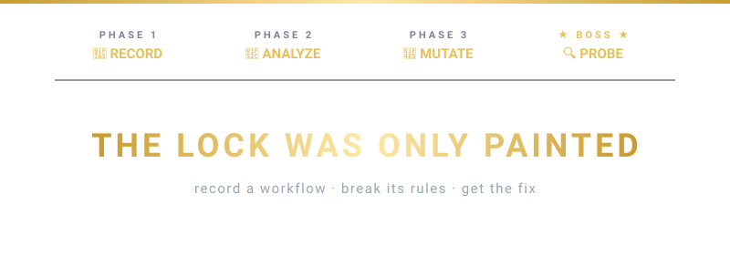
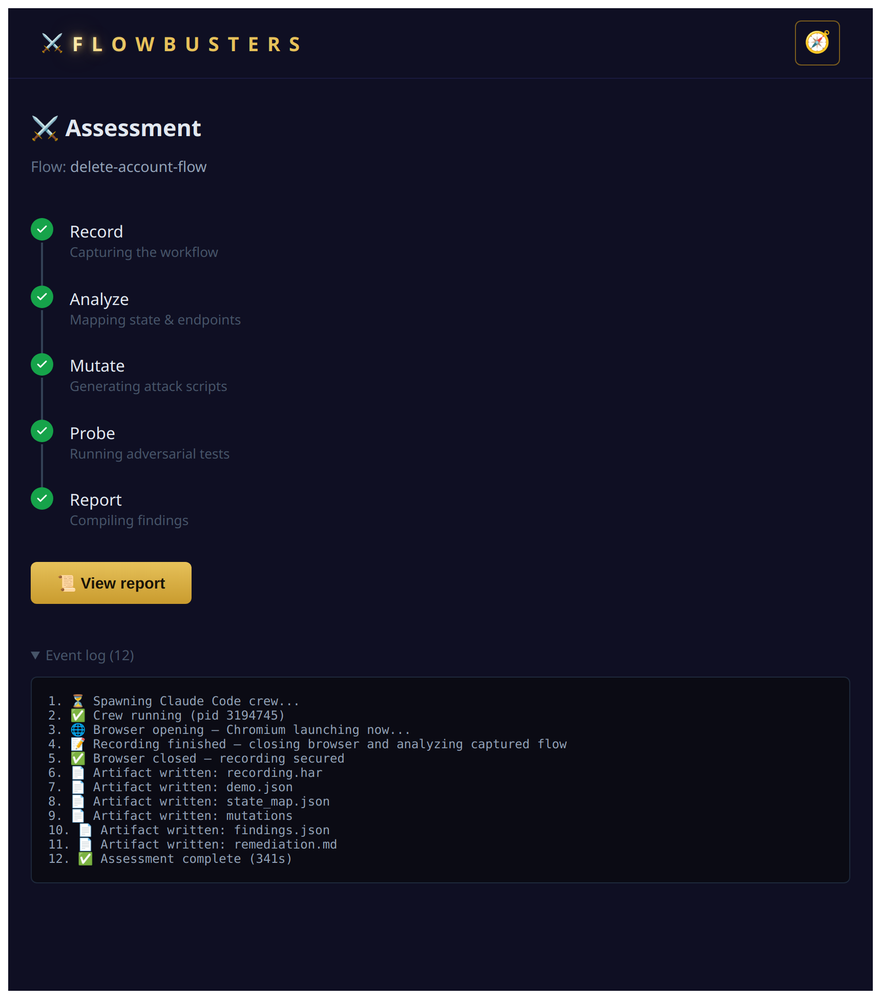

<p align="center">
  
</p>

# FlowBusters

**AI-assisted business-logic testing within and across recorded browser workflows.**

FlowBusters is a security research proof of concept. It captures UI context and
HTTP traffic from legitimate workflows, uses AI agents to propose abuse tests,
and runs supported HTTP probes through a backend execution and verification
pipeline.

**AI proposes. The backend executes and verifies. A human reviews whether the
inferred business rule reflects the intended business behavior.**

> [!IMPORTANT]
> ### Experimental MVP / Proof of Concept
> FlowBusters is an active research prototype. It is **not production-ready**
> and is not a hardened or sandboxed security platform.
>
> **Authorized testing only. Use only against non-production applications you
> own or have explicit permission to test.**

## The problem

Traditional scanners are good at testing individual endpoints and known
vulnerability patterns. Business-logic flaws often appear only when someone
breaks the sequence, roles, or assumptions built into a workflow.

FlowBusters explores cases such as skipping required steps, replaying completed
actions, swapping roles, tampering with prices or state, and accessing workflow
endpoints directly.

## How it works

**Record → Analyze → Mutate → Probe → Report**

| Phase | What happens | Output |
|:---|:---|:---|
| **Record** | The backend launches Playwright MCP. You perform an authorized workflow while changed semantic UI states and HTTP requests/responses are captured. | `demo.json`, `recording.har` |
| **Analyze** | AI analyzes recorded evidence and infers states, transitions, role contexts, and candidate business rules. | `state_map.json` |
| **Mutate** | AI proposes structured test plans using relevant attack patterns. The backend checks admissibility and compiles accepted plans into supported probes. | `*.plan.json`, generated `*.py` |
| **Probe** | The backend executes probes, records actual requests/responses and state observations, and verifies supported claims. | Execution logs and verified outcomes |
| **Report** | Findings, execution coverage, supporting evidence, and AI-suggested remediation are assembled for review. | `findings.json`, `remediation.md` |

<p align="center">
  
</p>

## Components

| Component | Responsibility |
|:---|:---|
| React portal | Starts assessments, selects recordings for cross-flow analysis, streams progress, and renders reports |
| FastAPI backend | Coordinates capture, validates plans and evidence references, generates supported probes, executes them, and verifies results |
| Playwright MCP | Provides the browser interface used by backend-controlled recording |
| Claude Code analysis session | Analyzes evidence, infers candidate rules, and proposes tests and remediation |
| HTTP probes | Exercise supported test plans outside the browser |
| Report | Separates findings from probe attempts, coverage gaps, unsupported claims, and errors |

The crew's named roles describe analysis responsibilities. Operational browser
startup, probe execution, and final evidence verification are handled by the
backend.

## Attack patterns

Patterns guide hypothesis generation; they are not findings. Agents use recorded
states and transitions to suggest relevant tests. Applicability depends on the
available requests, credentials, state evidence, and supported checks.

| Pattern | Test idea |
|:---|:---|
| `SKIP_STEP` | Attempt a later action without completing a required prerequisite |
| `ROLE_SWAP` | Attempt an action using another authorized user or role context |
| `DATA_TAMPER` | Modify identifiers, statuses, or other values affecting workflow state or ownership |
| `MASS_ASSIGNMENT` | Submit fields the user should not be allowed to control |
| `PRICING_TAMPER` | Manipulate submitted prices, discounts, amounts, or quantities |
| `DOUBLE_SPEND` | Attempt to obtain repeated financial value from an operation |
| `REPLAY_ATTACK` | Resubmit a request after it should no longer be accepted |
| `FORCED_BROWSING` | Directly request a resource or endpoint that should be restricted |
| `STATE_INTERLEAVING` | Combine conflicting actions or workflow sequences to test shared-state consistency |

## Cross-flow analysis

Some flaws appear only when separate workflows interact. FlowBusters can combine
selected recordings from the same application environment and compatible version,
build a shared application state map, and propose tests that mix actions across
workflow boundaries.

For example, a price adjustment followed by a completed refund may return more
money than the customer originally paid. Testing only either workflow in isolation
can miss that interaction.

Source references are retained so proposed actions can be traced to recorded
evidence. A visible but unrecorded UI action can suggest an investigation; its
visibility alone does not supply an executable API request. Cross-flow analysis
reuses selected recordings rather than requiring a new combined browser recording.

## Validation and verification

Before execution, backend checks include configured scope, recorded endpoints and
methods, field paths, source evidence, supported claim/predicate combinations, and
independent test setup. Unsupported or invalid plans must remain distinguishable
from executed tests.

For supported probes, the backend records execution evidence including the script
hash, HTTP trace, and state observations. Execution records are integrity-signed
locally and checked before their evidence is accepted. This ties a result to the
saved script and captured execution; it does not establish that an AI-inferred
business rule is correct.

The final application state is checked against the tested rule. For an amount
bound, the supported `sum_lte` invariant can check whether the sum of returned
amounts remains less than or equal to the original payment.

**HTTP 200 alone does not prove a vulnerability.**

| Result | Meaning |
|:---|:---|
| `CONFIRMED` | Verified execution evidence demonstrates a violation of the tested rule |
| `NOT_REPRODUCED` | The executed test did not reproduce the proposed violation |
| `NEEDS_REVIEW` | Evidence or evaluation is insufficient or inconclusive |
| `NOT_EXECUTED` | The test did not run, for example because a required prerequisite was unavailable |
| `CHECK_ERROR` | Execution or evidence evaluation failed; this is not a confirmed finding |

Reports distinguish findings from individual probe attempts and expose coverage
gaps and unsupported claims separately. Multiple attempts may relate to the same
finding. A `NOT_REPRODUCED` result does not establish that the application is secure.

Inferred business rules, severity, CWE mappings, and remediation suggestions
require human review.

## Quickstart

### Prerequisites

Install or have access to:

- Python 3
- Node.js and npm
- Google Chrome
- Claude Code CLI
- Anthropic API key

Playwright MCP is installed automatically by the repository's root
`npm install`. No separate global Playwright MCP installation is required.

### Configure

```bash
git clone https://github.com/allmighty-tiger/FlowBusters.git
cd FlowBusters
cp .env.example .env
npm install
cp mcp.json.example mcp.json
```

Set `ANTHROPIC_API_KEY` in `.env`.

The root `npm install` installs `@playwright/mcp`. FlowBusters uses this package
to record browser interactions.

The default MCP configuration uses the locally installed Google Chrome browser:

```json
{
  "mcpServers": {
    "playwright": {
      "command": "<repo-root>/node_modules/.bin/playwright-mcp",
      "args": ["--browser", "chrome", "--ignore-https-errors"]
    }
  }
}
```

On Windows, the executable may be:

```text
<repo-root>\node_modules\.bin\playwright-mcp.cmd
```

Replace `<repo-root>` with the absolute path to your local FlowBusters
repository.

Because the configuration uses `"--browser", "chrome"`, Google Chrome must be
installed on the system. A separate global Playwright MCP installation is not
required.

### Start the backend

```bash
python -m venv .venv
source .venv/bin/activate
pip install -r backend/requirements.txt
pip install python-dotenv
uvicorn backend.api.main:app --port 8000
```

On Windows PowerShell, activate the environment with:

```powershell
.\.venv\Scripts\Activate.ps1
```

Do not use `--reload` during an assessment; it can terminate the active crew.

### Start the frontend

In a second terminal:

```bash
cd frontend
npm install
npm run dev
```

Open:

```text
http://localhost:3000
```

Configure `scope.json` for your approved non-production target before starting.
The backend requires the scope file and checks the target before browser capture.
The `block_production` flag is a configuration gate; the tool does not automatically
determine whether a target is production.

Enter the target URL, start an assessment, complete the workflow in Chromium, and
select **Finish recording**. Review the resulting findings, execution evidence,
and inferred business rules.

For cross-flow analysis, select multiple compatible recordings in the Applications
view and confirm that they belong to the same application environment and version.
The current backend supports one active assessment at a time.

## Configuration

| Variable | Purpose | Default |
|:---|:---|:---|
| `ANTHROPIC_API_KEY` | Anthropic API credentials | none |
| `ANTHROPIC_MODEL` | Model used by the crew | `claude-sonnet-5` |
| `CREW_EFFORT` | Claude Code reasoning effort | `medium` |
| `ARTIFACTS_DIR` | Assessment artifact root | `.` |
| `CLAUDE_CODE_BIN` | Claude Code executable | `claude` |
| `MCP_CONFIG_PATH` | Playwright MCP configuration | `./mcp.json` |
| `CREW_DIR` | Crew definitions | `./crew` |\n| `SETUP_PATHS` | Comma-separated test setup endpoints; used for setup, not as attack targets | `/api/demo/reset` in `.env.example` |

## Assessment artifacts

The current layout nests flow-specific artifacts inside each assessment run:

```text
runs/{run-name}/
├── scope.json
├── flows/{flow-name}/
│   ├── demo.json
│   ├── recording.har
│   └── state_map.json
├── mutations/{flow-name}/
│   ├── *.plan.json
│   └── *.py
└── reports/{flow-name}/
    ├── executions/
    ├── findings.json
    └── remediation.md
```

Additional artifacts depend on the run mode and validation path. Cross-flow runs
also retain source recordings and references, the shared application state map,
and cross-flow candidates. Rejected plans and correction feedback may be retained
for review.

`demo.json` contains a compact UI workflow timeline rather than a full DOM dump:
deduplicated UI states, visible before/after differences, and a value-free network
outline. The recorder redacts selected sensitive values from this agent-facing
context; do not assume all captured information is sanitized. HAR files can
retain authentication credentials and sensitive request/response data.

Legacy reports may contain raw labels such as `BUG_FOUND`, `REJECTED`, or
`ERROR`. These are not substitutes for the current verified outcomes above.

## Safety

FlowBusters executes generated HTTP probes against configured targets. The backend
compiles supported structured plans and validates execution evidence, but these
checks do not provide a hard operating-system sandbox.

Claude Code currently runs with `--dangerously-skip-permissions`; the main analysis
session's tool list is restricted to `Read,Write,Edit,Glob,Grep`. Tool restrictions
and instructions to treat recorded content as untrusted data are partial
mitigations, not proof that prompt injection is prevented.

Use a disposable, isolated environment; test only non-production systems; use
synthetic data and least-privileged accounts; inspect generated probes; and
treat HAR files, tokens, scripts, and reports as sensitive.

`scope.json` is a workflow guardrail, not a security boundary. Enforce scope
independently with network controls, dedicated credentials, and target-side
access controls.

Read [`SECURITY.md`](SECURITY.md) before running an assessment.

## Limitations

- Results depend on the completeness of recorded UI and HTTP evidence.\n- Cross-flow recordings must represent the same environment and compatible application version.\n- Only supported claim/predicate combinations can be checked automatically; other hypotheses need review.\n- Only one assessment can run at a time.
- Authentication and complex multi-user state may require manual handling.
- Generated tests can contain false positives or invalid assumptions.
- The MVP is not hardened for production deployment.
- FlowBusters does not replace manual penetration testing, code review, threat
  modeling, or conventional security scanning.

## Responsible Use

> [!WARNING]
> **FlowBusters is an offensive-security research project intended exclusively
> for authorized testing.**
>
> You are responsible for obtaining permission, defining scope, protecting
> captured data, reviewing generated probes, and complying with all applicable
> laws and organizational policies.

The presence of technical access, a reachable endpoint, or a permissive
`scope.json` does not constitute authorization. You remain responsible for
every request executed through FlowBusters and every effect it has on the
target.

<p align="center">
  <sub>FlowBusters — record a workflow, break its rules, get the fix.</sub>
</p>
