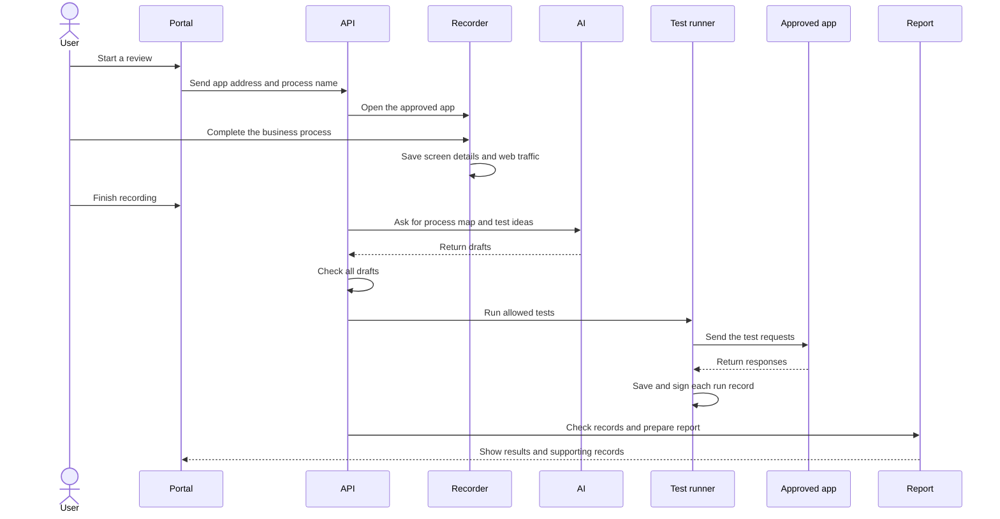
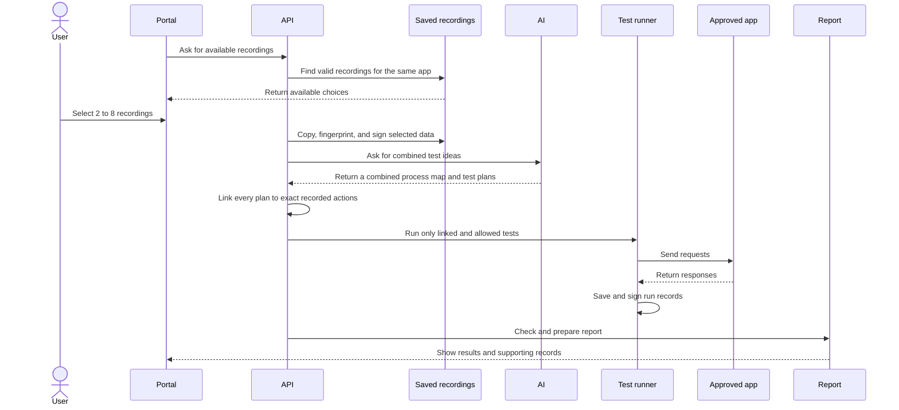

# FlowBusters architecture in plain business language

## What the system does

FlowBusters records an approved business process and asks AI to suggest ways the
process could go wrong. The backend checks those ideas, runs supported tests,
records the real web requests and responses, and prepares the final report.

AI can suggest an issue, write a test plan, and draft report text. AI does not
make the final decision. A reported issue must be supported by a signed run
record, matching web traffic, and an approved business rule.

FlowBusters supports two types of review:

- **Recorded-process review:** tests one recorded business process.
- **Combined-process review:** joins two to eight matching recordings to look
  for problems caused by using business processes together.

Main code: [run setup](../backend/runtime/orchestrator.py),
[AI work manager](../backend/runtime/crew_runner.py),
[test runner](../backend/runtime/probe_executor.py), and
[report checks](../backend/runtime/verification.py).

## Quick system map

| Part | What it does |
|---|---|
| Web portal | Starts reviews, shows progress, and displays reports. |
| FastAPI service | Receives requests from the portal and allows one active review at a time. |
| Browser recorder and Playwright MCP | Playwright MCP opens and controls the browser while the backend records approved user actions, readable screen text, and web traffic. |
| AI Analyst | Reads the recording and creates a map of the business process. |
| AI test writer | Suggests focused test plans and draft report text. |
| Backend test runner | Checks each plan, runs it once, and records what happened. |
| Traffic recorder | Records every supported web request and response in order. |
| Signing service | Signs run records so later file changes can be found. |
| Business rule list | Stores approved rules for known apps and versions. |
| Report service | Checks the run records, groups matching issues, and prepares the report. |

The Captain, Analyst, Saboteur, and Prober names are AI roles inside one AI
process. They are not separate services. The browser recording finishes before
the AI work begins.

Code: [portal](../frontend/src/pages/portal.tsx),
[API](../backend/api/main.py), [recorder](../backend/runtime/recorder.py),
[AI manager](../backend/runtime/crew_runner.py),
[test runner](../backend/runtime/probe_executor.py), and
[report service](../backend/runtime/verification.py).

## Recorded-process review



### Steps and what happens when something fails

| Step | Main owner | What happens | If it fails |
|---|---|---|---|
| Prepare | Backend | Checks the process name, app address, and allowed scope. Creates the run folder. | The review stops before the browser opens. |
| Record | Backend, Playwright MCP, and browser | Playwright MCP opens and controls the browser. The backend saves a small set of screen details plus request and response data. | If Playwright MCP is unavailable, the browser closes, required traffic is missing, or the recording times out, the review stops and the AI work does not start. |
| Map the process | AI Analyst | Creates a map of states, actions, screens, and API calls. | The backend may allow up to two limited correction attempts. Tests stay blocked until the map passes. |
| Suggest tests | AI test writer | Creates focused test plans and draft issue text. | Missing or badly formed plans stop the run or stay marked for review. |
| Run tests | Backend | Runs each allowed test, records all traffic, and signs the result. | The failed run stays visible. A serious test-format error stops later AI tests. |
| Build report | Backend | Matches the written test to the signed traffic and approved rule. | The result is shown as needing review or as a check error. |

The recording is trusted only as a record of what the user did. It is not proof
that a later security test ran. The later test needs its own signed run record.

## Combined-process review



### Rules for choosing recordings

A recording can be used when:

- it is a normal recorded-process run, not another combined run;
- its recording files are complete and valid;
- its process map uses the current file format;
- its app address matches the other selected recordings; and
- its saved app identity matches when identity data is available.

A recording does not need to contain a security finding. A clean recording with
no test scripts can still be useful input. This only means that the recording is
complete enough to use; it does not mean the app was safe.

The user must select two to eight different recordings. Unsafe folder names,
duplicate choices, mixed apps, old file formats, changed files, and files that
are too large are rejected.

### How combined test ideas are checked

The backend copies the selected recordings into the new run. It creates a
SHA-256 fingerprint for each copy and signs a list of all selected files. Later
checks use these copies, not files that AI can replace.

Each AI test idea must:

- use actions found in at least two selected recordings;
- point to the exact request method, address, body, and response status;
- use one exact runnable test plan;
- keep the same issue statement during any correction; and
- use an approved business rule when it claims a confirmed business problem.

Shared read-only requests, filenames, file order, or simply listing a second
recording are not enough. If no idea passes, the review stops before testing. If
some ideas pass, only their matching tests run.

Each recording starts its screen step count at 1. For that reason, a screen step
in a combined review is identified by both the recording name and the step
number.

Code: [combined-run setup](../backend/runtime/application_model.py) and
[combined-plan checks](../backend/runtime/candidate_correction.py).

## Files created during a run

Paths below are inside `runs/{run-id}/`.

| File | Created by | How it is used |
|---|---|---|
| `flows/{flow}/demo.json` | Browser recorder | Small screen samples and a short network timeline. It may miss fast screen changes. |
| `flows/{flow}/recording.har` | Browser recorder | Full recorded request and response list used to understand the business process. |
| `recording_source.json` | Backend recheck command | Signed list showing which earlier recording was copied for a new review. |
| `flows/{flow}/state_map.json` | AI Analyst | Draft map of screens, actions, and app states. The backend checks all links before use. |
| `application_identity.json` | Backend | Signed app name and version used to select the correct business rules. |
| `flows/{flow}/cross_flow_candidates.json` | AI Analyst | Combined-process test ideas. They are not proof that a test ran. |
| `mutations/{flow}/*.py` | AI test writer | Test code. The backend treats it as unsafe input and checks it before use. |
| `reports/{flow}/executions/{id}.json` | Backend test runner | Signed record of the test code, time, output, errors, and full web traffic. |
| `reports/{flow}/findings.json` | AI first, backend report work later | Starts as a draft. The final screen uses signed run data when available. |
| `reports/{flow}/remediation.md` | AI | Draft fix advice. It is guidance, not proof. |
| API report response | Backend | Final view used by the portal. It keeps findings, test runs, partial data, and setup-only runs separate. |

For a single recorded-process recheck, the backend copies only the original
recording, the finish marker, and the allowed scope. It does not copy old AI
maps, old tests, old reports, or old run records.

## What the system trusts

### AI output

AI output is always a draft. This includes process maps, test ideas, scripts,
findings, fix advice, response text, and summary counts. Writing
`validated: true` does not make a record trusted.

### Signed run records

A run record is used only when its HMAC signature matches the local key. The
record includes:

- the exact test code and its SHA-256 fingerprint;
- start and finish times;
- the command and exit code;
- exact program output and errors;
- the test's data result;
- all captured requests and responses; and
- the backend's own check result.

HMAC signing can show that a saved file changed after this FlowBusters install
signed it. It does not provide outside proof, prove who owns the target app, or
protect against a person who controls both the files and the local key.

### Approved business rules

Business rules come from backend-managed files, not from AI. A rule is used only
when the signed app identity, app version, rule-list version, and exact business
check all match.

The run name, folder name, app address, screen button, API field, and AI text do
not create a business rule.

Code: [app identity](../backend/runtime/application_identity.py),
[business rules](../backend/runtime/business_requirements.py),
[app list](../backend/runtime/applications.json), and
[rule list](../backend/runtime/business_requirements.json).

### Recorded screen details

The recorder saves readable screen details at set times. It removes repeated
lines, empty items, tool-only IDs, and obvious secrets. It stores at most 80
unique items and 6,000 characters in each sample. It does not save screenshots
or a full copy of the page.

A saved screen fact is accepted only when it points to the exact saved item and
step. A button state change must show the same named button before and after.
Text that appears must be missing before and present once after. API field
changes stay labeled as API facts; they are not changed into screen facts.

These samples show what was present at the time of each sample. They do not prove
that a specific click caused a specific request.

## How a test result is checked

For a supported business-number test, the backend expects:

1. A read of the starting state.
2. Every action that changes data, in order.
3. A read of the final state.
4. A clear true-or-false answer based on the final response.
5. A business rule that matches the written issue.

The traffic recorder gives every request an order number. The backend makes sure
the test plan contains every recorded request exactly once and does not hide any
data-changing action. It reads the numbers from the signed final response and
checks the calculation again.

If the test's answer disagrees with the signed response, the system reports an
error and stops later AI-written tests. It does not change the answer into a
successful result.

A reset request may prepare the test data. A test mainly about reset behavior
stays visible in the run list but does not count as a security finding.

## Report result meanings

| Result | Meaning |
|---|---|
| `CONFIRMED` | The signed test finished, the traffic matched, the final response broke the exact approved business rule, and the test supported the written issue. |
| `NOT_REPRODUCED` | The signed test finished and the tested business rule was met. This applies only to that exact test and does not prove the whole app is safe. |
| `NEEDS_REVIEW` | Some useful data exists, but the rule, action list, issue wording, or final check is incomplete or does not match. |
| `CHECK_ERROR` | The test process, signature, data reading, or traffic check failed, so no reliable result can be given. |
| `NOT_EXECUTED` | The test did not run because a needed starting condition was missing. It remains a coverage gap. |

An HTTP success or error code alone does not prove a security issue or a working
control.

## Counts shown in the report

The report keeps these items separate:

- **Security findings:** completed issues shown to the user.
- **Test results:** one backend result for every trusted run record.
- **Partial data:** useful extra traffic that does not contain a complete test.
- **Setup-only runs:** visible records that mainly test demo setup behavior.
- **Run counts:** planned tests, attempts, signed records, pending tests, and
  errors.
- **Grouped issues:** matching findings shown as one product issue.

Two runs are grouped only when their app and rule details, ordered
data-changing requests, request bodies, timing style, and business check match.
Titles, risk ratings, CWE numbers, and AI wording do not decide the group.

Grouping means that several runs showed the same kind of product issue. It does
not prove that they came from the same line of source code.

## Limited correction of AI work

### Process map correction

The backend first tries one safe automatic fix for a screen pointer that is a few
positions off. It changes the pointer only when exactly one item in the same
screen sample matches the original role, name, or text. It does not change the
claim or create a new fact.

If that does not work, AI may receive up to two read-only correction attempts.
The AI receives the same saved recording, the rejected map, and a clear error.
It cannot use shell commands, write files, run tests, or change the original
claim. The backend checks the full answer again.

Corrections are blocked after any test run record exists. The backend also makes
sure the original recording did not change during correction. All attempts and
errors are saved for later review.

Code: [map correction](../backend/runtime/state_map_correction.py).

### Combined test idea correction

Combined test ideas may also receive up to two read-only correction attempts.
The issue ID, issue statement, and action order cannot change. The backend again
links the idea to exact requests from at least two signed recording copies and
to exactly one test plan.

A test idea with no match or more than one match stays unverified and does not
run. Saved backend tests are kept separate and cannot be presented as AI-created
combined-process discoveries.

Code: [combined test correction](../backend/runtime/candidate_correction.py).

## Northstar example

The Northstar app source is not stored in this project. FlowBusters can show what
happened during a signed test, but it cannot prove why Northstar behaved that
way internally.

The example test performs these steps:

1. Read the order with `GET /api/order`.
2. Send a price change with `POST /api/order/price-adjustment`.
3. Request a refund with `POST /api/order/refund/request`.
4. Complete the refund with `POST /api/order/refund/complete`.
5. Read the final order with `GET /api/order`.

In the saved example, the final response shows:

- price adjustment: `$30`;
- completed refund: `$100`;
- total returned: `$130`; and
- original amount: `$100`.

The approved rule `NSM-TOTAL-RETURN-CAP-2026-09-17` says that the total returned
must not be greater than the original amount after any action. The backend reads
the final signed response and checks that `$30 + $100 > $100`. AI text is not
used as the calculation.

The rule applies only when the signed identity is `northstar-market`, the app
version is accepted, and the rule-list version matches. A folder name or local
web address is not enough.

The portal shows the amount calculation, rule date, state changes, and complete
ordered traffic. It keeps the signed facts separate from suggested fixes.

## Current readiness

The current system can:

- record one approved process;
- combine two to eight matching recordings;
- create and check AI test plans;
- run supported web tests;
- record and sign the complete traffic;
- apply approved business rules;
- show findings, run results, gaps, and grouped issues separately; and
- keep old process maps readable as unverified records.

On September 18, 2026, a local read-only check of
`cross-flow-f9dbb26f37e2` showed:

- six displayed security findings;
- one `CONFIRMED` finding;
- five `NOT_REPRODUCED` findings;
- seven signed test results;
- two confirmed test results that were grouped into one displayed finding;
- six AI-created test results; and
- one saved-backend-test result.

This is a dated local result. It is not a promise that every future run will have
the same counts, and it does not prove that the issue can be found only through a
combined-process review.

## Running the system

### Services and ports

| Service | How it runs |
|---|---|
| Backend API | `uvicorn backend.api.main:app --port 8000` |
| Web portal | Run from `frontend/` on port `3001` |
| Browser tool | Started by the backend only when recording is needed |
| AI worker | Started for each review and stopped when its work finishes |
| Northstar | Runs from its own project; this project does not include its server |

### Start order

1. Start the approved target app and confirm its address is allowed by
   `scope.json`.
2. From the project root, start the backend:

   ```powershell
   .\.venv\Scripts\python.exe -m uvicorn backend.api.main:app --host 127.0.0.1 --port 8000
   ```

3. Do not use `--reload` during a review. Restarting the backend can lose the
   active in-memory job and stop its child process.
4. Start the portal:

   ```powershell
   npm --prefix frontend run dev -- --host 127.0.0.1 --port 3001 --strictPort
   ```

5. Open `http://127.0.0.1:3001`.
6. Choose **Start Assessment** for one recording or **Application Model** for a
   combined-process review.

### Recheck an existing recording

Use a new destination name:

```powershell
.\.venv\Scripts\python.exe -m backend.runtime.reanalyze --source demo-ready-refund-v1 --destination demo-ready-refund-v1-reanalysis-new
```

The command checks the original recording before copying it. It copies only the
recorded screen and traffic data, finish marker, and scope. It signs a list of
the copied files, turns off browser recording, and sends the copy through the
normal AI review, test, and report steps.

### Storage and safe restart

Run data is stored under `${ARTIFACTS_DIR:-.}/runs/{flow-name}/`. The local
signing key is stored under `execution_keys/` and is not part of a report.

For a safe restart:

1. Wait for the progress screen to show `complete` or `failed`.
2. Do not restart the app or backend while tests are running.
3. Stop the portal.
4. Stop the backend.
5. Restart the target app if needed.
6. Start the backend without `--reload`.
7. Start the portal.

Use a new process name for a new recording. Keep old run files and signed
records in place.

## Report loading problems

If a saved combined-test approval file has a bad signature, FlowBusters does not
sign it again or confirm its findings. The report list shows an unavailable row
with the error, while other reports remain readable. Opening that report returns
HTTP 422 with the reason.

## Known limits

- Screen details are samples taken about once per second by default. Fast changes
  can be missed.
- Screen samples contain limited readable text, not screenshots or a full page
  copy.
- Old process maps remain readable but cannot support a newly confirmed screen-
  based issue.
- The test runner is not a full operating-system security sandbox. Run it only
  against approved, temporary targets.
- General number tests currently support only `sum_lte`, which checks whether a
  total stays below or equal to a limit.
- A final number limit cannot prove whether the server wrongly accepted an input
  field. Those claims remain `NEEDS_REVIEW` unless a suitable check exists.
- A pending child process, such as an unfinished refund, cannot support a clean
  negative result. The process must finish and the final state must be read.
- The API stores the active review in memory and supports only one review at a
  time. It is not a long-term job system for several servers.
- The local app identity address can be copied by a harmful local service. It is
  useful for the controlled demo but is not strong proof of the running server.
- Local HMAC signing does not protect against someone who controls both the
  saved data and the signing key.
- Combined-process mode proves that actions from separate signed recordings were
  joined into a new test. It does not prove that a normal review could not find
  the same issue.
- One grouped issue does not prove one internal code cause.
- Requests sent one after another do not prove a timing problem. A timing claim
  needs proof that requests overlapped or were run together.
- The current Northstar confirmed-issue text assumes a price change followed by
  a completed refund. It should not be reused for a different action sequence.
- AI may guess an API address from response data. A guessed address stays only a
  test idea until a backend-run test records it.
- An HTTP status code by itself never proves a security issue or a working
  control.
- The project does not contain the Northstar server source or start command.

## Where to review the code

1. [Test runner](../backend/runtime/probe_executor.py): runs tests, records
   traffic, signs run records, and compares the saved result with the traffic.
2. [Report service](../backend/runtime/verification.py): assigns report results,
   checks whether a test supports its issue, and groups matching issues.
3. [Business rules](../backend/runtime/business_requirements.py): finds the
   approved rule for the signed app and version.
4. [App identity](../backend/runtime/application_identity.py): checks the local
   app identity and creates its signed record.
5. [Combined-run setup](../backend/runtime/application_model.py): selects and
   copies matching recordings.
6. [Combined test correction](../backend/runtime/candidate_correction.py): links
   AI ideas to exact recorded actions and one runnable test.
7. [Browser recorder](../backend/runtime/recorder.py): saves screen samples and
   web traffic.
8. [Portal report view](../frontend/src/components/ReportView.tsx): displays
   results, supporting records, counts, and suggested fixes.

For presentation guidance, see [DEMO-CHEATSHEET.md](DEMO-CHEATSHEET.md). For
common review questions, see [TECHNICAL-DEFENSE.md](TECHNICAL-DEFENSE.md).
