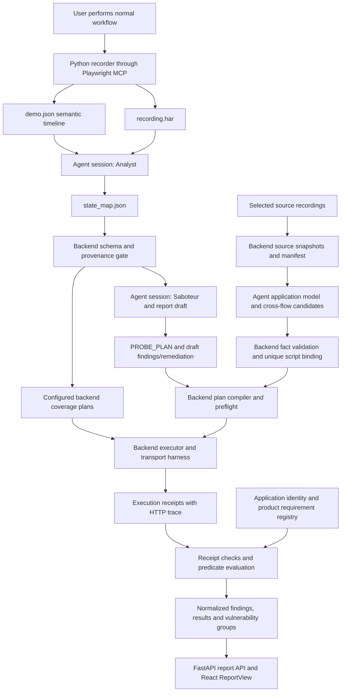

# FlowBusters engineering Lunch & Learn

Preparation review: September 19, 2026. Audience: engineers, architects and security practitioners. Presenter: a security engineer describing a personal proof of concept developed outside assigned work. This document provides the requested outline and speaker notes, not an exported slide deck. English copy is ready to adapt into slides. Keep source references in speaker notes or the appendix.

Repository inspected: branch `fixes`, HEAD `1a1ec10`, including the current uncommitted implementation. This is deliberately a working-tree review, not a claim that HEAD alone contains everything described below. No assessment or probe was launched for this review. Saved reports were loaded through the current backend and their receipts authenticated. Existing evidence was not edited.

## 1. What FlowBusters actually does today

The experiment uses a human-recorded workflow to provide context for adversarial test generation. Python owns browser recording through Playwright MCP, artifact validation and probe execution. The agent session interprets the recording, proposes hypotheses and authors test plans. Current plans can compile into a fixed Python executor template. The backend compares declared captures against captured HTTP events, evaluates a supported predicate and resolves rule authority before normalizing findings. Northstar additionally has product-specific endpoint and coverage configuration. This is a hybrid of model reasoning and explicit application knowledge.

Status labels below describe scope, not production readiness. IMPLEMENTED means a concrete code path exists. PARTIALLY IMPLEMENTED means important parts of the broad capability are missing. EXPERIMENTAL means the code runs but its reasoning/search quality has no established general coverage guarantee. NOT IMPLEMENTED means no corresponding mechanism was found in the reviewed path.

| Capability | Status | Current behavior and evidence |
|---|---|---|
| Recording HTTP traffic | IMPLEMENTED | `recorder.record` calls Playwright MCP. `dump_capture` exports request details and available bodies, then invokes `synthesize_har.py`. This is reconstructed HAR 1.2, not a packet capture. [Recorder](../backend/runtime/recorder.py), [HAR conversion](../crew/scripts/synthesize_har.py), functions `dump_capture`, `entry_to_har`. |
| Recording completeness | PARTIALLY IMPLEMENTED | Missing request details/bodies fail recording. Some unrecoverable response bodies are tolerated and marked when they do not exceed half the requests. A validated recording marker therefore does not promise every response body exists. `dump_capture`; [recording source validation](../backend/runtime/endpoint_catalog.py), `validate_recorded_input`. |
| Semantic UI snapshots | IMPLEMENTED | `browser_snapshot` supplies accessibility-oriented text. `compact_snapshot` strips MCP refs, bounds each snapshot to 80 element strings / 6,000 characters and truncates lines to 300 characters. This is lossy semantic text, not full DOM or screenshots. [Recorder](../backend/runtime/recorder.py), `compact_snapshot`. |
| Timeline and differences | IMPLEMENTED | Initial, sampled and final snapshots. Default interval 1 second, configurable within 0.25–10 seconds. Equal snapshots merge observations. Differences are appeared/disappeared strings, capped at 30 per direction. `record`, `add_ui_state`. |
| Exact click/network causality | NOT IMPLEMENTED | `demo.json.workflow_timeline` contains `ui_states` and a separate `network_sequence`. Its `correlation_note` explicitly calls for order/URL/semantic interpretation. There are no instrumented click IDs joining the two streams. `record`, `network_sequence`. |
| UI rule extraction | EXPERIMENTAL | Analyst proposes structured facts and inferences in `state_map.json`. Facts can be checked, but a visible button does not independently establish a financial limit. [Analyst charter](../crew/agents/analyst/charter.md), [UI validator](../backend/runtime/ui_provenance.py), `validate_observed_ui_rule`. |
| State-map schema and correction | IMPLEMENTED | New maps use schema 2 and observed-rule schema 1. Exact pointers, source, step, text/role/name and transition values are checked. A deterministic unique locator repair precedes up to two agent correction proposals. Corrections preserve claims and source hashes and occur before execution. `validate_state_map`, `relocate_ui_pointers`, [correction](../backend/runtime/state_map_correction.py), `correct_state_map`. |
| Cross-flow source collection | IMPLEMENTED | User chooses 2–8 ordinary recordings. Backend validates recordings/state maps, common origin and compatible identity metadata. An empty agent report does not itself disqualify a source. [Application model](../backend/runtime/application_model.py), `validated_source`, `collect`. |
| Application state model | EXPERIMENTAL | Agent-authored `application_state_map.json` and aggregate `state_map.json` represent inferred relationships. This is not a formally complete transition system or model checker. `CROSS_FLOW_INSTRUCTIONS`; [runner](../backend/runtime/crew_runner.py), `run_crew`. |
| Cross-flow candidate provenance | IMPLEMENTED | Candidates need real state-changing HAR references from at least two source runs. Backend validates pointers/methods/URLs/statuses against authenticated snapshots. It binds a unique compiled probe contract by equality of actions/bodies/reads/invariant. [Candidate gate](../backend/runtime/candidate_correction.py), `validate_candidate`, `_bind_candidate_scripts`, `correct_candidates`. |
| Candidate search quality | EXPERIMENTAL | An agent proposes candidates. Two correction attempts can repair invalid provenance. Remaining invalid candidates become unverified coverage. No valid candidates means failure to check cross-flow. This is not exhaustive enumeration. `correct_candidates`. |
| Probe generation | IMPLEMENTED | AI can emit literal `PROBE_PLAN`. Backend validates and compiles it into an atomic setup/before/actions/after program. Arbitrary legacy Python still exists on a separate preflight path. [Compiler](../backend/runtime/generated_probes.py), `read_plan`, `validate_plan`, `render_plan`, `compile_plans`. |
| Deterministic demo coverage | IMPLEMENTED | Northstar version 2 has explicit price tamper, refund replay, cancel tamper and combined-flow plans. Preconditions use recorded workflow paths and identity. [Coverage config](../backend/runtime/coverage_plans.json), [generator](../backend/runtime/coverage_plans.py), `prepare_coverage_probes`. These are authored coverage, not AI discoveries. |
| Execution and trace collection | IMPLEMENTED | Backend snapshots script bytes, starts a child process and records terminal output. Harness wraps HTTPX, requests and urllib, capturing sequences, method/URL/body, status/response and timing. [Executor](../backend/runtime/probe_executor.py), `execute`; [harness](../backend/runtime/probe_capture.py), `main`. |
| Execution evidence integrity | IMPLEMENTED within a local trust model | Backend stores HMAC-protected execution records. Loader rechecks HMAC and capture/trace correspondence. The harness explicitly is not a hostile-code sandbox. HMAC does not defeat an operator controlling both key and files. `execute`, `load_receipts`, `trace_error`; `probe_capture.main`. |
| State/predicate evaluation | PARTIALLY IMPLEMENTED | Monetary `sum_lte` supports exact numeric response-root paths and finite values. Backend recomputes from final GET. Approved-item deletion and auth checks have separate logic. This is not an arbitrary business-rule solver. `resolve_numeric_path`, `trace_error`; [verifier](../backend/runtime/verification.py), `classify`, `_classify_business_rule`, `_classify_auth`. |
| Rule authority | IMPLEMENTED for the configured product predicate | Product rule matches authenticated app ID, accepted identity version, requirements version and exact invariant dictionary. Free-form agent references do not authorize the monetary rule. [Registry](../backend/runtime/business_requirements.json), [matching](../backend/runtime/business_requirements.py), `apply_backend_requirements`. |
| Application identity | PARTIALLY IMPLEMENTED | Allowed origin plus exact response from registry-configured `/.well-known/flowbusters-identity`; backend protects saved metadata with HMAC. A different response fails closed. A server deliberately impersonating the endpoint is not cryptographically distinguished. [Identity](../backend/runtime/application_identity.py), `discover_application_identity`, `issue_identity`, `validate_identity`. |
| Claim/predicate alignment | PARTIALLY IMPLEMENTED | Plans require a claim type. Report checks catch known pending-payout and amount-input/mass-assignment mismatches. Some checks use title/mutation labels. This is not a general proof that arbitrary natural-language claims equal predicates. `validate_plan`; `_claim_coverage_error`, `_endpoint_coverage_error`. |
| Findings and accounting | IMPLEMENTED with presentation limitations | Authenticated primary executions replace stale unexecuted drafts in memory. Exact action/invariant duplicates collapse. A separate vulnerability grouping can collect payload variants. Results retain all authenticated receipts. UI still has overly general Northstar prose and some severity inherited from drafts. `reconcile`, `normalize_report`, `_dedup_key`, `_unique_vulnerabilities`; [ReportView](../frontend/src/components/ReportView.tsx), `ReportView`. |
| General application documentation export | NOT IMPLEMENTED | The Application Model page displays saved model JSON. Confluence/Lucidchart export or a verified application-wide dependency graph was not found. [Page](../frontend/src/pages/applications.tsx), `ApplicationsPage`. |

### The current architecture



Arrows describe artifact dependencies, not separate deployed services. Analyst and Saboteur are responsibilities expressed through the agent runner and charters. Do not imply a dedicated independently deployed worker for every character in the crew. See `build_system_prompt` and `run_crew` in [crew_runner.py](../backend/runtime/crew_runner.py). Cross-flow compilation and binding are coordinated before execution; `correct_candidates` requires the already compiled script representation.

| Component | Inputs | Outputs / responsibility |
|---|---|---|
| React Portal | Target, flow name, source selection | Assessment API requests, SSE progress, report views. `PortalPage`, `ApplicationsPage`, `ReportView`. |
| FastAPI | Assessment request or selected runs | One active run per API process, event stream and report endpoints. [main.py](../backend/api/main.py): `start_assessment`, `start_cross_flow`, `stream_progress`, `get_report`. |
| Recorder / MCP | Target and configured scope, human browser workflow | `flows/{flow}/har_data`, HAR, demo timeline, validation marker. `record`, `dump_capture`. |
| Analyst | HAR, timeline, endpoint catalog, instructions | State map and structured proposed rules. Cross-flow also produces application model/candidates. Analyst charter; `CROSS_FLOW_INSTRUCTIONS`. |
| Artifact/provenance gate | State map and raw artifacts | Accepted map or bounded correction with precise errors. `ArtifactWatcher.check`, `validate_final_state_map`, `correct_state_map`. |
| Saboteur / agent reporting | Model, catalog and contracts | AI-selected plans and pre-execution drafts. [charter](../crew/agents/saboteur/charter.md); [execution contract](../crew/skills/probe-flow/EXECUTION.md). |
| Plan compiler / candidate binder | Literal plan, exact candidate contract, source facts | Deterministic Python script and authorized script set. `compile_plans`, `correct_candidates`. |
| Executor | Authorized scripts and scope/catalog | Per-attempt receipt, raw output, HTTP events. `execute_run`, `execute`, harness `main`. |
| Verifier / loader | Receipt plus draft, identity and rules | Atomic findings, partial coverage, setup exclusions, execution accounting. `load_report`, `reconcile`, `normalize_report`. |

### Artifact examples worth explaining

The saved price recording has four semantic states. Its initial state includes `button "Cancel order" [cursor=pointer]`. The final state no longer includes that button, but still includes `button "Request refund" [cursor=pointer]`. Steps 2 and 3 contain the adjustment dialog. These are sampled observations, not four clicks. Local observation: `demo-ready-price-v1/flows/demo-ready-price-v1/demo.json`, `workflow_timeline.ui_states`.

An illustrative fact locator is:

```json
{
  "source_run": "price-source",
  "artifact": "demo.json",
  "json_pointer": "/workflow_timeline/ui_states/0/elements/12"
}
```

The array index is zero-based. The state's `step` is separately checked and starts at one. This example is a schema illustration, not an asserted index in the saved recording. `resolve_json_pointer` handles `~0` and `~1`, rejects malformed indexes and never recursively guesses a field. A before/after UI transition needs both states. `explicit_ui_text` points to an element, not a delta array. [ui_provenance.py](../backend/runtime/ui_provenance.py): `resolve_json_pointer`, `_state_for_pointer`, `_validate_ui_text`, `_validate_ui_transition`.

CFC-003 in the saved cross-flow has actual source facts:

| Source run | HAR pointer | Recorded action |
|---|---|---|
| `demo-ready-price-v1` | `/log/entries/1` | `POST /api/order/price-adjustment`, 200 |
| `demo-ready-refund-v1` | `/log/entries/1` | `POST /api/order/refund/request`, 201 |
| `demo-ready-refund-v1` | `/log/entries/2` | `POST /api/order/refund/complete`, 200 |

Those facts establish available recorded operations. The candidate's UI provenance motivates exploration but does not establish the financial cap. The independently approved registry rule supplies that authority. The shared-state inference and new ordering still need execution. [candidate_correction.py](../backend/runtime/candidate_correction.py), `validate_candidate`; [verification.py](../backend/runtime/verification.py), `_classify_business_rule`.

## 2. The technical evolution, corrected against history

The useful story is **network-oriented recording, richer sampled UI context, cross-flow composition, then stronger evidence and execution contracts**. It is too strong to say the early recorder had no UI data: the parent of `b98c15c` already called `optional_snapshot` at the start and end and saved those snapshots in `demo.json`.

| History evidence | What can honestly be said |
|---|---|
| `b98c15c^`, `recorder.record` | Early backend recording primarily represented actions through HTTP traffic but retained optional initial/final snapshots. |
| `b98c15c`, September 12 | Added compact semantic context, sampled timeline/deltas and agent ingestion instructions. Playwright was already present. This was richer use of it, not its first introduction. |
| `2d35bcc`, September 14 | Cross-flow/application-model implementation and evidence executor work enter the relevant history. |
| `9ab6d23`, September 15 | Structured UI provenance and atomic reporting. |
| `7dbb9f7`, September 16, and later changes | Reanalysis, requirements and execution-contract hardening. |
| Current worktree | Literal plan compilation, exact candidate binding, correction paths, endpoint catalog, backend coverage, report refinements. Some are uncommitted, so a commit-only presentation would miss current behavior. |

Commit dates document code history, not a controlled evaluation of improvement. Avoid claiming each stage increased accuracy by a measured amount. No before/after benchmark was established in this review.

Suggested personal narrative:

> I started from workflow recordings. Network traffic gave the system concrete requests, but not enough context to interpret the workflow. I added compact UI observations, then composed evidence from several recordings. The harder engineering work became deciding what the system was actually entitled to conclude. That led to stricter source references, execution records, and explicit business requirements.

## 3. Core presentation: 15 slides, 26 minutes

Use this as a 26-minute planned segment, including an 8-minute demo. Reserve roughly 15 minutes for questions and the rest of the hour for discussion and delays. Slides carry the short “On slide” text only. Speaker notes carry the explanation and references. The demo may use completed runs when a new assessment takes longer than the slot.

### Slide 1: Business logic testing

**Time/type:** 0:30, conceptual. **Purpose:** Establish the problem and personal context.

**On slide:** “Valid API operations can produce an invalid business outcome.” Small subtitle: “A personal engineering experiment.”

**Visual:** One ordinary transaction and its resulting state. No product feature list.

**Say:** “This is a personal proof of concept I built outside my normal work responsibilities. I wanted to explore how much workflow context helps an agent propose useful adversarial tests. I'll show the implementation, a controlled example, and where the approach still breaks down.”

### Slide 2: Coinbase's account and asset mismatch

**Time/type:** 2:00, technical example. **Purpose:** Show a relationship the API failed to enforce.

**On slide:** `source account asset == order-book asset`; “Balance validation alone was insufficient.”

**Visual:** Two fields, source account and order book, with the required equality between their assets.

**Say:** “Coinbase's February 2022 retrospective describes a trade request whose source account did not match the asset being sold. The balance check could succeed while that relationship was wrong. The mechanism matters here: validating fields independently can miss an invariant between them.”

**Source:** [Coinbase's retrospective](https://www.coinbase.com/en-gb/blog/retrospective-recent-coinbase-bug-bounty-award). [Salt's article](https://salt.security/blog/understanding-the-coinbase-api-vulnerability) is contextual reading. Prefer Coinbase for the mechanism and impact. Do not claim a completed theft or reproduce Salt's speculative catastrophic-impact framing. This example involves a modified request parameter, unlike Northstar's ordinary empty-body combination. Do not call them identical exploits.

### Slide 3: The missing test oracle

**Time/type:** 1:00, conceptual. **Purpose:** Define “invariant” simply.

**On slide:** “What must remain true?” `returned <= paid`; “Which actions can change it?”

**Visual:** Order value and two payout operations feeding one balance.

**Say:** “An invariant is a condition the product requires to remain true. For this demo, a customer must not receive more money than the order cost. The difficult question is often what condition to test and which actions share the state, rather than which malformed string to send.”

Do not present business logic and technical vulnerabilities as mutually exclusive categories. Both can involve unexpected inputs. The distinction here is the domain-specific oracle.

### Slide 4: The experiment

**Time/type:** 1:00, conceptual. **Purpose:** State the research question.

**On slide:** “Can workflow context help an agent propose useful adversarial tests?” “Observe / infer / execute / evaluate.”

**Visual:** Four labeled stages with one example at each.

**Say:** “I give the model a normal workflow and ask what could violate its assumptions. Proposed rules remain hypotheses. Execution and the final business decision have separate checks.” Reference: `build_system_prompt`, `run_crew`, `classify`.

### Slide 5: Network context and its limits

**Time/type:** 1:30, technical. **Purpose:** Explain the initial representation.

**On slide:** `POST /api/order/refund/request` / `201` / `refund.status = pending`; “A request does not explain every product assumption.”

**Visual:** A short HAR excerpt, not a full JSON dump.

**Say:** “HAR provides concrete HTTP evidence and replay inputs. It doesn't tell me whether a missing button expresses a business rule, a UI convention, or a transient rendering state. Early recording already kept endpoint snapshots, but the network sequence was the main description of actions.” References: `dump_capture`, `entry_to_har`; history `b98c15c^`.

### Slide 6: Architecture and responsibilities

**Time/type:** 2:00, technical. **Purpose:** Explain ownership.

**On slide:** Recorder, agent analysis, validated plan, backend execution, report. Show the requirement registry as an independent input to evaluation.

**Visual:** Use the architecture diagram above, simplified to six main boxes. Dashed outline around agent-authored artifacts. Separate the configured coverage input from AI plans.

**Say:** “The agent selects hypotheses and request sequences. The backend records browser evidence, validates artifacts, compiles supported plans, executes probes and computes verdicts. Northstar also has explicit coverage plans. Those plans improve demo repeatability, but their discovery is not evidence of an LLM capability.”

### Slide 7: Sampled UI context

**Time/type:** 1:30, technical. **Purpose:** Show the real semantic representation.

**On slide:** Before: `button "Cancel order"`; after: absent; “Sampled states, not instrumented clicks.”

**Visual:** Two short `elements` excerpts and their appeared/disappeared delta.

**Say:** “The recorder samples Playwright accessibility text approximately once a second. It removes refs and retains bounded strings. The model reads these beside the network sequence. Short-lived states can be missed. The timeline does not establish an exact click-to-request join.” References: `compact_snapshot`, `add_ui_state`, `record`.

### Slide 8: Facts and product rules

**Time/type:** 1:30, technical. **Purpose:** Separate evidence from authority.

**On slide:** UI fact: “Cancel disappears”; API fact: `cancelOrder=false`; product rule: `totalReturned <= originalAmount`.

**Visual:** Three rows, clearly different sources.

**Say:** “A UI affordance can motivate a test. It cannot prove a compensation policy. For Northstar I explicitly approved the financial cap as the test application's owner. The backend matches that configured rule to an application identity, requirements version and executable predicate.” References: `validate_observed_ui_rule`, `apply_backend_requirements`, `_classify_business_rule`.

### Slide 9: Cross-flow composition

**Time/type:** 1:30, technical. **Purpose:** Explain what the mode adds.

**On slide:** “Separate source recordings”; “Shared order state”; “Candidate cites at least two sources.”

**Visual:** Price and refund HAR facts feed one ordered candidate. Label both source IDs.

**Say:** “Cross-flow explicitly composes separate validated recordings and asks for interactions over shared state. Source-local step numbers need a source ID. The merged HAR is an evidence index, not a recording of one combined session. The new sequence must run before it counts as evidence.” References: `collect`, `prepare_inputs`, `validate_candidate`.

### Slide 10: A plan the backend can execute

**Time/type:** 1:30, technical. **Purpose:** Show the most concrete boundary.

**On slide:** Three method/path/body entries and the exact `sum_lte` predicate. Keep code to roughly 10 lines.

**Visual:** Plan excerpt next to `before GET / actions / after GET`.

**Say:** “Current plan-based probes let the agent choose the sequence while backend code supplies capture bookkeeping and arithmetic. Candidate binding compares the execution contract, not a filename. This avoids many generation failures, but the selected predicate still needs to represent the claim.” References: `validate_plan`, `render_plan`, `_bind_candidate_scripts`.

### Slide 11: Northstar demonstration

**Time/type:** 8:00, demo. **Purpose:** Show one combined-workflow defect clearly.

**On slide:** `$100 order`; `$30 adjustment + $100 refund`; `$30 overpayment`.

**Visual:** Live browser and report. Keep this slide ready as the fallback calculation.

**Say:** “The individual ordinary actions return 30 or 100 dollars. In this ordering, the refund calculation does not subtract the adjustment already issued. The final order state records 130 dollars returned. We compare that state with the explicitly approved 100-dollar cap.”

Follow the detailed demo plan below. Show an ordinary recording and one cross-flow run launch if the first run completes in time. Use completed evidence for the timed walkthrough instead of waiting indefinitely for a new generation.

### Slide 12: Evidence and result counts

**Time/type:** 1:00, technical. **Purpose:** Explain the actual result units.

**On slide:** “7 executions”; “2 positive executions”; “1 unique problem”; “5 negative scenarios”.

**Visual:** Two execution records converge on the one equivalent finding.

**Say:** “Six AI probes and one configured coverage probe ran in this saved assessment. Two reproduced the same action chain and predicate. They remain two executions, but the report groups the duplicate finding. Five other orderings hit workflow guards. That result says nothing about untested sequences.” References: `reconcile`, `_dedup_key`, `_unique_vulnerabilities`; saved observation below.

### Slide 13: What the evidence boundary checks

**Time/type:** 1:00, technical. **Purpose:** Explain protection against false attribution.

**On slide:** “Script snapshot”; “Exact HTTP trace match”; “Final-state recomputation”; “Applicable rule”.

**Visual:** One capture linked to the same sequence in an execution record.

**Say:** “The backend compares method, URL, body, status, response and sequence. It checks that state reads bracket the actions, rejects omitted requests and recomputes the result. The record's HMAC detects later modification without the key. This protects the local pipeline, not against a hostile operator or arbitrary Python controlling the harness.” References: `execute`, `load_receipts`, `trace_error`, `probe_capture.main`.

### Slide 14: Current limits

**Time/type:** 1:00, technical. **Purpose:** State unresolved engineering issues.

**On slide:** “Sampled UI correlation”; “Narrow predicate vocabulary”; “Local demo trust model”; “Incomplete coverage and report semantics”.

**Say:** “The system cannot prove general business correctness. UI-to-network correspondence is interpretive. Predicate-to-claim checks cover selected cases. The current report still has some overly specific Northstar copy. A completed run means the pipeline completed, not that all product behavior was tested.”

Use the limitations and challenge lists below if asked for concrete examples.

### Slide 15: Questions the experiment leaves open

**Time/type:** 1:00, discussion. **Purpose:** End with engineering questions.

**On slide:** “Which hypotheses need a model?” “Which rules should teams author?” “What coverage could we measure?” Small future-work note: “Workflow documentation from the same evidence”.

**Visual:** One open research question, with the remaining two in speaker notes if space is tight.

**Say:** “I would next measure which useful hypotheses the model adds over configured tests, and replace more ambiguous claims with executable contracts. The same observations might support workflow documentation, but a reliable exported application map is future work. I'd like your critique of where this boundary should sit.”

## 4. Reliable demo plan

### Local evidence reviewed for this talk

These are dated local observations, not permanent test fixtures or guaranteed future outputs. Paths are listed for local preparation without creating permanent links to ignored run artifacts.

| Run | Normalized findings C / review / negative | Execution results C / review / negative | Receipts | Unique problems |
|---|---|---|---|---|
| `demo-ready-price-v1` | 3 / 2 / 4 | 3 / 2 / 4 | 9 | 2 |
| `demo-ready-refund-v1` | 2 / 0 / 4 | 4 / 0 / 4 | 8 | 2 |
| `demo-ready-cancel-v1` | 3 / 1 / 4 | 3 / 1 / 4 | 8 | 3 |
| `cross-flow-f9dbb26f37e2` | 1 / 0 / 5 | 2 / 0 / 5 | 7 | 1 |

All listed receipts authenticate. Contract checks return `reviewable`, not `invalid`, for one unsupported-predicate receipt in price and one in cancel. The distinction matters: reviewable executions are not process or trace failures. The refund and cross-flow records have no such entries. Do not summarize the price/cancel runs as universally verified security checks simply because execution error counters are zero.

The combined payout exists in ordinary refund F-002 and cancel F-001 as well as cross-flow F-003. It is a cross-workflow defect, but not an exclusive discovery of the cross-flow mode. Ordinary agent probes may use other catalog endpoints. Do not relabel these three reproductions as three different product vulnerabilities.

### Starting state and environment

Use Northstar at `http://localhost:3000`, Portal at `http://127.0.0.1:3001`, backend at `http://127.0.0.1:8000`. Source code currently serves identity `{application_id: northstar-market, identity_version: "2"}` from `/.well-known/flowbusters-identity`. This review inspected code/evidence and did not claim live process availability. Northstar sources: `C:/Users/nasti/Documents/northstar-market/server.js`, `createApp`; `order-store.js`, `createInitialState`, `OrderStore`.

Before a rehearsal, with no assessment running, restore the fixture once:

```powershell
curl.exe -sS -X POST "http://localhost:3000/api/demo/reset" -H "Content-Type: application/json" --data-raw '{}'
curl.exe -sS "http://localhost:3000/api/order"
```

Required start: order `1042`, delivered, `originalAmount=100`, `totalReturned=0`, adjustment=0, refund completed amount=0, cancellation reimbursement=0, refund status=`none`. Reset is setup. Keep it in the operator checklist even though report attack steps hide it. Do not click around the target while probes are executing against the shared fixture.

### Eight-minute live segment

| Time | Presenter action | What to explain / fallback |
|---|---|---|
| 0:00–0:45 | Show the initial order and expected payout cap. | Establish the business oracle before showing a result. |
| 0:45–2:15 | In Portal `/`, choose a fresh name such as `lunch-refund-20260919-v1`, target `http://localhost:3000`, then Start Assessment. In the recording browser request refund, complete refund once, then Finish Recording. Follow any actual confirmation dialog. | A normal refund finishes at 100. The recorder exports HTTP and sampled UI evidence. Never reuse an occupied run ID. |
| 2:15–3:30 | Show the progress and a pre-opened saved `demo.json` excerpt. | Analyst, validation, plans, drafts, execution. Draft findings/remediation may appear before backend probes. Do not wait silently for generation. |
| 3:30–4:15 | If the ordinary assessment finished, open `/applications`, choose the Northstar environment, select the validated saved price/refund/cancel sources, check compatibility and Analyze 3 flows. | Use `demo-ready-price-v1`, `demo-ready-refund-v1`, `demo-ready-cancel-v1`. A new ordinary source can replace one only after it passes the gate. API allows one active assessment per process. |
| 4:15–6:45 | Open saved `cross-flow-f9dbb26f37e2`, F-003. Show adjustment, request, completion, final GET. | All three bodies are `{}`. Statuses 200, 201, 200. Final `adjustmentAmount=30`, `completedAmount=100`, cancellation=0, `totalReturned=130`, `originalAmount=100`. This is a 30-dollar excess in the demo ledger. |
| 6:45–7:30 | Expand expected rule and technical details, then one execution record. | Product rule came from owner approval. The UI button inference did not authorize the cap. Mention local HMAC only if the audience asks about integrity. |
| 7:30–8:00 | Point to one negative chain and the execution counts. | For example adjustment then cancel returns 409 and ends at 30. Two positive executions represent one problem. Stop the demo on time. |

If the first assessment is still running at the cross-flow slot, show the source selection UI and use the saved completed cross-flow report. Say, “This is a previous completed execution against this demo version; the new analysis is still running.” Do not imply the saved report belongs to the just-started run. The two new assessments cannot be guaranteed to finish inside eight minutes. If starting both live is mandatory, begin the ordinary run earlier in the presentation and retain the same explicit fallback.

The attack sequence itself is deterministic in the current in-memory Northstar handlers, but generation time and chosen AI scenarios are not. Northstar `requestRefund` sets the requested amount to the original 100 without subtracting the issued price adjustment. `completeRefund` adds that amount. `totalReturnedCents` sums compensation counters. See `order-store.js`, `requestPriceAdjustment`, `requestRefund`, `completeRefund`, `totalReturnedCents`, and `test/workflows.test.js`, TEST F.

### Pre-opened material

- Portal `http://127.0.0.1:3001/`, Application Model `/applications`, saved report `/cross-flow-f9dbb26f37e2/report`.
- Ordinary refund `/demo-ready-refund-v1/report`, F-004, if showing refund replay as the ordinary assessment example. Its F-002 is already the combined-flow problem, so name the distinction.
- `runs/demo-ready-price-v1/flows/demo-ready-price-v1/demo.json`, only the relevant `ui_states`.
- `runs/cross-flow-f9dbb26f37e2/flows/cross-flow-f9dbb26f37e2/cross_flow_candidates.json`, CFC-003.
- `runs/cross-flow-f9dbb26f37e2/reports/cross-flow-f9dbb26f37e2/executions/03_price_then_refund_complete-ccb4f4b42bbd4d9eb67f770bd414cbb5.json`, `trace` and `parsed_result.verification`.
- `backend/runtime/generated_probes.py`, `render_plan`, and `backend/runtime/business_requirements.json` for questions.

For browser/Portal failure, use the already-open local JSON and the calculation slide. For API/model failure, use the saved execution and identify it as saved. For a new validation error, show the precise error, acknowledge it and continue the saved walkthrough. Do not alter evidence or invent a successful run. Avoid opening complete environment files, credential sections or execution keys on the projector.

### Rehearsal commands, not executed by this review

From `C:\Users\nasti\Documents\FlowBustersPortal\FlowBusters`:

```powershell
.\.venv\Scripts\python.exe -m uvicorn backend.api.main:app --host 127.0.0.1 --port 8000
npm --prefix frontend run dev -- --host 127.0.0.1 --port 3001 --strictPort
```

Use separate terminals. From `C:\Users\nasti\Documents\northstar-market`: `npm start`. These commands assume installed environments. An occupied port is a reason to inspect the existing process, not start another copy. Do not restart the backend during an assessment.

## 5. Technical appendix slides

Appendix slides do not count toward the 26 minutes. Use one per question, not a second lecture.

| Appendix | Suggested contents | What it establishes |
|---|---|---|
| A1 Full architecture | The dependency diagram and module table above | Real components and the agent/backend boundary. |
| A2 Timeline anatomy | One semantic state, `step`, `elements`, `changes_from_previous`, separate `network_sequence` | Lossy sampling and absence of exact click correlation. |
| A3 Source provenance | CFC-003's three HAR facts from two sources | Source facts, local pointers and why source IDs are necessary. |
| A4 Executable plan | Example below plus `render_plan` | Backend-controlled capture mechanics, AI-controlled action selection. |
| A5 Verification | Method/body/status/response/sequence equality, bracketing reads, exact predicate | What false attribution checks actually test. |
| A6 Rule authority | Identity endpoint, app registry, requirement registry, final-state comparison | Context identity is a local demo convention and the cap is independently asserted. |
| A7 Counting | 7 receipts, 7 execution results, 6 normalized findings, 1 unique vulnerability | Exact duplicate chains differ from vulnerability grouping. |
| A8 Correction and failure | Original map/candidate, structured error, bounded proposal, gate | Corrections do not make unsupported claims authoritative. |
| A9 Threat model | Agent process, harness, local key, target, external model boundary | Trusted local operator, no hostile-code isolation guarantee. |
| A10 Engineering debt | UI prose, semantic matching heuristics, generic auth/deletion branch, benchmark gap | Limits worth discussing concretely. |

Example plan, reflecting the current compiler schema:

```python
PROBE_PLAN = {
    'schema_version': 1,
    'title': 'Price adjustment followed by completed refund exceeds order value',
    'origin': 'http://localhost:3000',
    'setup': '/api/demo/reset',
    'state_read': '/api/order',
    'actions': [
        {'method': 'POST', 'path': '/api/order/price-adjustment', 'body': {}},
        {'method': 'POST', 'path': '/api/order/refund/request', 'body': {}},
        {'method': 'POST', 'path': '/api/order/refund/complete', 'body': {}},
    ],
    'claim_type': 'amount_bound',
    'predicate': 'business_rule_must_hold',
    'invariant': {
        'operator': 'sum_lte',
        'terms': [['order', 'totalReturned']],
        'limit': ['order', 'originalAmount'],
    },
}
```

The template obtains its sequence number from `response.extensions['flowbusters_sequence']`. It computes the boolean using its own final response. The backend checks that capture against transport and recomputes the arithmetic. This example is a presentation excerpt; it was not executed during this review.

### The five implementation details most worth presentation time

1. **Structured context with explicit provenance.** Show how a UI fact points into the source rather than asking the audience to trust a paragraph. Include the sampling limit so provenance is not confused with completeness.
2. **Plan compilation and exact contract binding.** A concrete response to brittle generated Python and renamed scripts. The model still chooses an imperfect plan, but it no longer needs to hand-code every capture sequence.
3. **Independent product-rule authority.** Explain why a visible action and an arithmetic observation cannot create a financial policy. This is the central test-oracle problem.
4. **Execution reconciliation.** Method/body/response/sequence matching, final GET, and stale draft replacement directly address hallucinated or wrongly attributed findings.
5. **Results versus findings versus problem groups.** Counting distinctions expose repeated evidence without inflating discoveries. Payload-insensitive grouping remains a heuristic and deserves scrutiny.

## 6. Skeptical principal-engineer review

| Weak claim or risk | What the current code actually supports | What to say or show |
|---|---|---|
| “We added Playwright after HAR.” | Playwright and initial/final snapshots already exist before `b98c15c`. | “We expanded the semantic context and sampled timeline.” |
| “We know which click caused each request.” | Ordering/URL/semantics, not an event-ID join. | Show the literal `correlation_note`. |
| “The model discovered the payout rule.” | Owner-approved registry rule. UI provenance cannot establish the arithmetic cap. | Show rule registration separately from CFC-003. |
| “Cross-flow uniquely finds this issue.” | Ordinary refund F-002 and cancel F-001 already executed it. | Distinguish multi-workflow defect from discovery mode. |
| “All tests are AI-generated.” | A versioned Northstar profile explicitly supplies one relevant coverage plan. | Show `probe_origin` and the profile. Measure AI contribution separately in future. |
| “Every CONFIRMED card explains the right mechanism.” | `ReportView` currently renders combination/no-tampering/no-replay prose for all CONFIRMED cards. This is wrong for amount tamper and refund replay. | For this talk, use the accurate cross-flow card and exact requests. Do not read that boilerplate in the ordinary refund card. Presentation bug remains to fix separately. |
| “Severity is computed from verified impact.” | `_normalize_presentation` still retains draft severity in important confirmed paths. | Treat severity/CWE as classifications needing reviewer judgment. |
| “Humanized business rules preserve every original nuance.” | `businessRequirementStatement` uses statement-text patterns to generalize a compensation cap. | Show the registered rule when precision matters. It is not a general semantic translator. |
| “The compiler proves the natural-language claim.” | Plan typing plus selected title/mutation heuristics. | Demonstrate a bound; acknowledge unsupported field-trust or workflow predicates. |
| “The local identity endpoint proves the process.” | Self-reported app/version checked against configured origin. An impersonator can copy the response. | Call it a controlled-demo identity handshake. HMAC protects the saved record afterward. |
| “Run metadata is a perfect historical attestation.” | `apply_backend_requirements` chooses timing using report `run_timestamp`; `load_report` applies the rule before later metadata enrichment. Identity validation compares against the current registry. | Avoid broad claims about historical version/date attestation. Recommend trusted receipt-time binding and version-history tests as future hardening. |
| “HMAC prevents a malicious agent from fabricating evidence.” | Agent CLI uses `--dangerously-skip-permissions`; the Python harness is explicitly not a hostile-code sandbox. | Claim consistency checks against mistakes under a trusted local operator. A real adversarial boundary needs isolated workers and keys. |
| “Every byte of recording data is immutable from browser capture.” | Cross-flow snapshots serialize parsed JSON and hash a canonical source payload at selection. They do not attest historical bytes before selection or provide WORM storage. | Explain the exact point where snapshot integrity begins. |
| “No contract error means the claim passed.” | `unsupported_business_rule` can be `reviewable` with no execution error. | Keep review findings visible and inspect the predicate. |
| “One unique vulnerability is a proven root-cause grouping.” | `_unique_vulnerabilities` groups by app/rule/resource/endpoint order/predicate/overlap and omits payload differences. | Say “report grouping”, not a general proof of identical root cause. |
| “Normal workflows are safe.” | Ordinary individual calls respect the cap, but Northstar intentionally also has amount tamper and replay defects. | Qualify the statement to the demonstrated ordinary inputs and single completion. |
| “We demonstrated money moving.” | Northstar updates an in-memory ledger. | Say “the application recorded an overpayment”, not real payment-processor settlement. |
| “The model cannot see sensitive response data.” | Prompts instruct minimization, but the agent has file access to HAR/raw artifacts. | Do not claim a technical data-loss prevention boundary. Use synthetic local data. |
| “This replaces manual business-logic testing.” | No search-completeness proof, accuracy benchmark or production-scale validation in this review. | Present a context and test-generation experiment with measurable future questions. |
| “Two new assessments fit the eight-minute demo.” | External agent generation, corrections and one active run can exceed that time. | Use the explicit saved-evidence fallback and identify each run. |

No code fixes are bundled with this presentation preparation. The most visible remaining defect is the unconditional combined-workflow explanation in ordinary confirmed cards. The architecture also needs stronger deployment/worker boundaries before making hostile-agent or production claims.

## Reading order for the presenter

First rehearse slides 1–4 and 11 aloud. Then understand the plan, final GET and registered cap without reading notes. Finally use [the Q&A](LUNCH-AND-LEARN-QA.md) to practise answers at increasing depth. It is acceptable to say “I have not evaluated that yet.” Avoid claiming implementation expertise in an area solely because generated tests pass.
